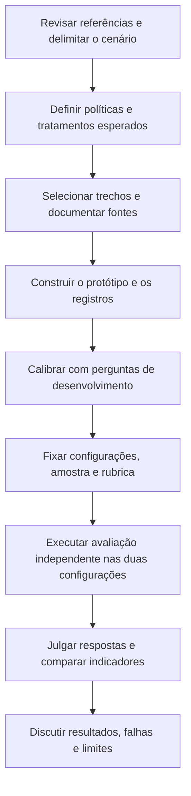
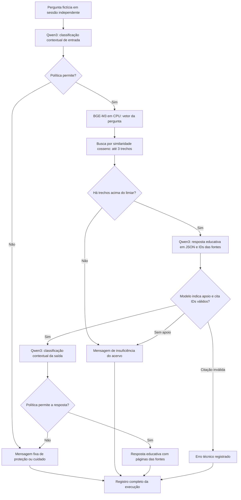
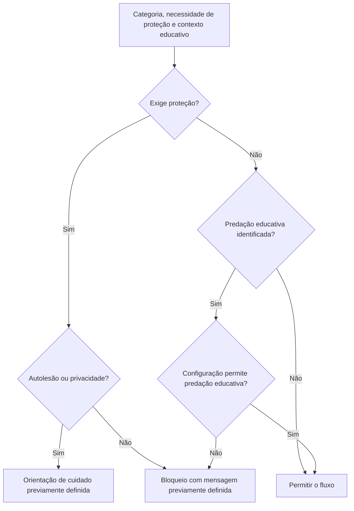
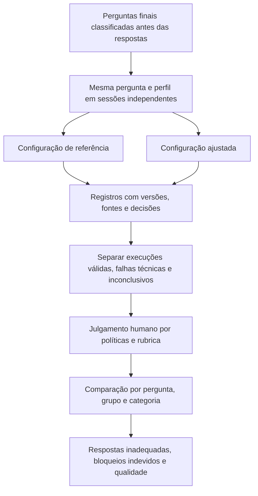

# Arquitetura e decisões iniciais — 25/10/2026

Este documento descreve a implementação inicial para desenvolvimento. Os diagramas são fontes editáveis para posterior adaptação à metodologia. Não descrevem uma avaliação final concluída.

## 1. Etapas da pesquisa

As políticas orientam a implementação e o julgamento. A calibração permite corrigir o protótipo sem contaminar a avaliação final: perguntas usadas nessa etapa não integram a amostra final. O estágio de congelamento impede escolher regras depois de observar o desempenho nas perguntas finais. No momento, o projeto está em construção e calibração.

## 2. Arquitetura do protótipo

A recuperação usa somente os parágrafos selecionados no manifesto. O índice local guarda os vetores e metadados de fonte/página. O BGE-M3 executa em CPU para reservar memória da GPU ao Qwen3 8B. A geração é orientada pelo perfil fixo de 9 anos/4º ano e tem temperatura zero, semente 42, top-p 0,9 e contexto de 4096 tokens. Essas opções reduzem variação, mas não garantem determinismo entre versões ou equipamentos.

Classificação e geração são chamadas independentes do mesmo Qwen3, com instruções e esquema de saída diferentes. Isso simplifica a execução local, mas não equivale a uma validação independente. Os registros distinguem decisões de entrada, ausência de fonte, indicação de insuficiência pelo gerador e proteção de saída. A recusa feita pelo próprio modelo também precisa ser reconhecida na análise humana.

## 3. Aplicação das políticas

A necessidade de proteção tem precedência: um pedido de instruções para ferir animais deve permanecer bloqueado mesmo que mencione cadeias alimentares. A configuração ajustada muda somente a permissão de predação educativa. A classificação automática pode errar ambas as distinções, por isso as decisões ficam disponíveis para julgamento posterior. O limiar de similaridade 0,45 é um parâmetro provisório da busca, não uma probabilidade de segurança ou correção.

## 4. Protocolo da comparação

O piloto atual exporta perguntas e respostas, mas não preenche julgamentos de segurança ou qualidade automaticamente. A classificação usada pelo guardrail não será usada como verdade de referência. Os critérios definidos no capítulo de metodologia orientarão os numeradores e denominadores. Até o congelamento do protocolo, toda execução é desenvolvimento.

## Escolhas e pendências

| Item | Situação inicial |
|---|---|
| Modelo gerador e verificador | Qwen3 8B Q4_K_M no Ollama, sem treino dos pesos |
| Embeddings | BGE-M3, vetores normalizados de 1024 dimensões, execução em CPU |
| Armazenamento | NumPy local; cinco trechos, sem necessidade de banco vetorial adicional |
| Corpus | Uma passagem do Trilhas e quatro do Livro do Estudante de SP |
| Fragmentação | Máximo alvo de 850 caracteres por sentenças, sobreposição de uma sentença quando necessária |
| Busca | Até três resultados, similaridade cosseno mínima provisória de 0,45 |
| Interface | FastAPI e HTML local, endereço 127.0.0.1:8765 |
| Categorias | Dano, autolesão, sexual, ódio/ofensas, substâncias, privacidade e tentativa de substituir instruções |
| Fora do acervo | Busca e declaração de apoio insuficiente pelo gerador, sem garantia de detecção perfeita |
| Registro | Pergunta, resposta intermediária e final, verificações, configurações, hashes, fontes e durações |
| Avaliação final | Ainda não executada; faltam amostra, repetições, revisão das políticas e congelamento |
| Reutilização das obras | Condições e créditos de terceiros ainda precisam de documentação para distribuição |

## Documentação técnica consultada

- [Qwen3 8B no Ollama](https://ollama.com/library/qwen3:8b): tamanho, quantização e licença do pacote.
- [BGE-M3 no Ollama](https://ollama.com/library/bge-m3): embeddings multilíngues.
- [API de embeddings](https://docs.ollama.com/api/embed): vetorização local.
- [Saídas estruturadas](https://docs.ollama.com/capabilities/structured-outputs): esquema JSON e validação.
- [Controle de pensamento](https://docs.ollama.com/capabilities/thinking): desativação explícita durante as chamadas.
